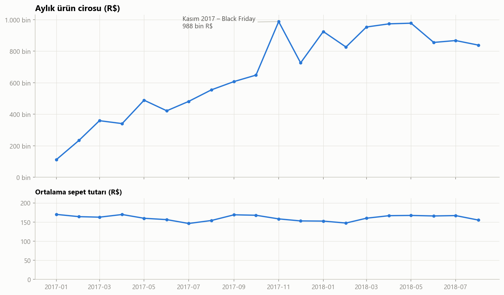
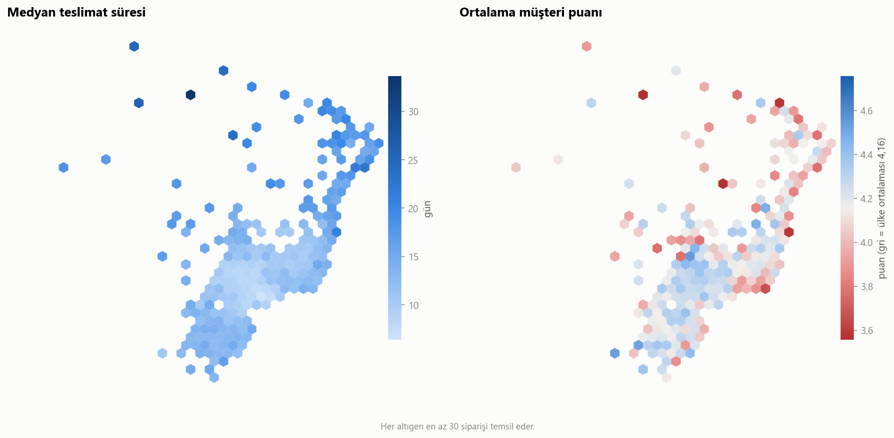
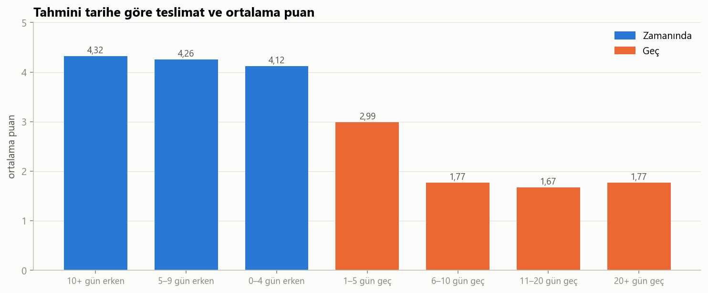
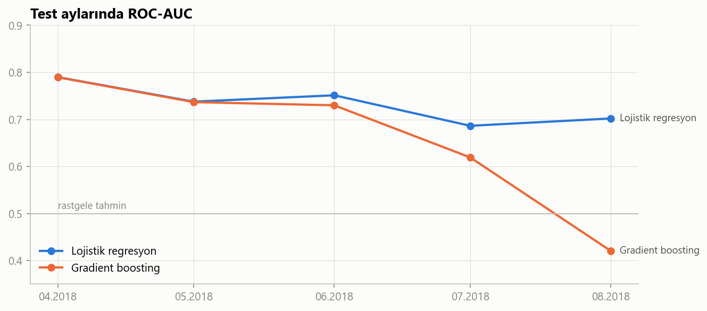

# Brezilya E-Ticaret Veri Analizi (Olist)

Brezilya'daki Olist pazaryerinin ~100 bin siparişlik açık veri seti üzerinde uçtan uca bir veri analizi projesi.
Proje dört notebook ve etkileşimli bir dashboard'dan oluşuyor: keşifsel satış analizi, coğrafi analiz, Portekizce yorumlarla duygu analizi ve geç teslimat tahmin modeli.

| Bölüm | İçerik |
|---|---|
| [01 · Satış analizi](01_satis_analizi.ipynb) | Satış trendleri, kategoriler, bölgeler, teslimat–puan ilişkisi, ödeme, RFM segmentasyonu |
| [02 · Coğrafi analiz](02_cografi_analiz.ipynb) | Müşteri/satıcı haritaları, teslimat süresi ve puan haritaları, mesafenin etkisi, eyaletler arası akış |
| [03 · Duygu analizi](03_duygu_analizi.ipynb) | TF-IDF + lojistik regresyon duygu modeli, şikâyet konuları, anket zamanlaması |
| [04 · Geç teslimat modeli](04_gec_teslimat_modeli.ipynb) | Zamana göre doğrulanmış sınıflandırma modeli, dönemsel performans, rejim değişikliği |
| [Dashboard](https://tekfora.github.io/brezilya-eticaret-analizi/dashboard/olist_panosu.html) | Dönem, eyalet ve kategoriye göre filtrelenebilen tek dosyalık HTML pano |

**Canlı dashboard:** https://tekfora.github.io/brezilya-eticaret-analizi/dashboard/olist_panosu.html

## Öne çıkan bulgular

**Satış**
- Ocak 2017 – Ağustos 2018 arasında **96.203** teslim edilmiş siparişten **13,2 milyon R$** ürün cirosu elde edildi. 2018'in ilk 8 ayı, bir önceki yılın aynı dönemine göre **%141 büyüdü**.
- Büyümenin kaynağı sipariş sayısı; ortalama sepet ~160 R$ seviyesinde sabit kaldı. Müşterilerin yalnızca **%3'ü** ikinci kez sipariş verdi.

**Teslimat ve coğrafya**
- Satıcıların **%60'ı São Paulo**'da. Medyan satıcı–müşteri mesafesi 436 km. 100 km'nin altında medyan teslimat 5 gün, 2.000 km'nin üstünde 18 gün.
- **Rio de Janeiro** São Paulo'ya yalnızca ~360 km uzakta olmasına rağmen geç teslimat oranı São Paulo'nun iki katı (%11'e karşı %5). Mesafeyle açıklanamayan bir son kilometre sorunu var.

**Müşteri memnuniyeti**
- Geç teslim edilen siparişlerin **%62'si 1–2 puan** aldı; zamanında teslim edilenlerde bu oran %9.
- Ancak geç siparişlerin **~%75'inde değerlendirme anketi ürün ulaşmadan gönderilmiş**. "Ürünü almadım" yorumlarının çoğu ürün henüz yoldayken yazılmış.
- Teslimat zamanında olduğunda şikâyetler ürüne kayıyor: eksik, yanlış, hasarlı ürün ve kalite.

**Tahmin modeli**
- Lojistik regresyon modeli, en riskli %10'luk siparişte geç siparişlerin **%31,5'ini** yakalıyor (rastgele seçimin 3,2 katı).
- Ağustos 2018'de aynı eyalet içi siparişlerin tahmini süresi yaklaşık yarıya indirildi ve bu siparişlerin geç oranı **%2'den %10'a** çıktı. Daha karmaşık olan gradient boosting modeli bu rejim değişikliğinde çöktü.






## Veri seti

[Brazilian E-Commerce Public Dataset by Olist](https://www.kaggle.com/datasets/olistbr/brazilian-ecommerce) (Kaggle). 9 ilişkili CSV tablosu:

| Tablo | İçerik |
|---|---|
| `olist_orders_dataset` | Sipariş durumu ve tarihleri |
| `olist_order_items_dataset` | Sipariş kalemleri, fiyat, kargo ücreti |
| `olist_products_dataset` | Ürün kategorisi ve fiziksel özellikleri |
| `olist_customers_dataset` | Müşteri şehri ve eyaleti |
| `olist_sellers_dataset` | Satıcı şehri ve eyaleti |
| `olist_order_payments_dataset` | Ödeme türü ve taksit |
| `olist_order_reviews_dataset` | 1–5 müşteri puanı ve Portekizce yorumlar |
| `olist_geolocation_dataset` | Posta kodu koordinatları |
| `product_category_name_translation` | Kategori adlarının İngilizce çevirisi |

## Yöntem

- **Temizleme:** Seyrek aylar (2016 ve Eylül–Ekim 2018) çıkarıldı, analizler teslim edilmiş siparişlerle yapıldı, yinelenen yorumlar tekilleştirildi. Ortak kurallar [ortak.py](ortak.py) içinde.
- **Coğrafya:** Posta kodu öneki başına medyan koordinat; satıcı–müşteri mesafesi haversine formülüyle hesaplandı.
- **Duygu analizi:** Puanlar zayıf etiket olarak kullanıldı (1–2 olumsuz, 4–5 olumlu). Olumsuzluk sözcükleri korunarak TF-IDF (tekli ve ikili kelime grupları) ve lojistik regresyon uygulandı. Şikâyet konuları anahtar kelime kurallarıyla belirlendi.
- **Model:** Yalnızca sipariş anında bilinen özellikler kullanıldı. Satıcı ve kategori için çapraz doğrulamalı hedef kodlama uygulandı. Eğitim Ocak 2017 – Mart 2018, test Nisan–Ağustos 2018 verisiyle yapıldı ve performans ay ay izlendi.

## Çalıştırma

### 1. Veriyi indirin

Ham CSV dosyaları boyutları nedeniyle (toplam ~120 MB) depoda yer almıyor.

1. [Kaggle veri seti sayfasından](https://www.kaggle.com/datasets/olistbr/brazilian-ecommerce) ZIP dosyasını indirin.
2. ZIP'teki 9 CSV dosyasını, notebook'larla aynı klasöre (deponun kök klasörü) çıkarın.

Kaggle CLI kuruluysa tek komutla da indirebilirsiniz:

```bash
kaggle datasets download -d olistbr/brazilian-ecommerce --unzip
```

### 2. Notebook'ları çalıştırın

```bash
pip install -r requirements.txt
jupyter notebook
```

Notebook'lar numara sırasıyla okunacak şekilde yazıldı; her biri bağımsız olarak da çalışır. Grafikler `gorseller/` klasörüne kaydedilir.

Dashboard'u yeniden üretmek için:

```bash
python dashboard/panel_verisi.py
```

Bu komut veriyi ay × eyalet × kategori küpüne özetler ve `dashboard/olist_panosu.html` dosyasını oluşturur. Dosya herhangi bir tarayıcıda doğrudan açılır, sunucu gerektirmez. Pano GitHub Pages üzerinden de yayında (bağlantı yukarıda).

## Lisans

- **Kod:** [MIT](LICENSE)
- **Veri:** Olist tarafından [CC BY-NC-SA 4.0](https://creativecommons.org/licenses/by-nc-sa/4.0/) lisansıyla yayınlanmıştır. Bu proje Olist ile bağlantılı değildir; bağımsız bir analizdir.
